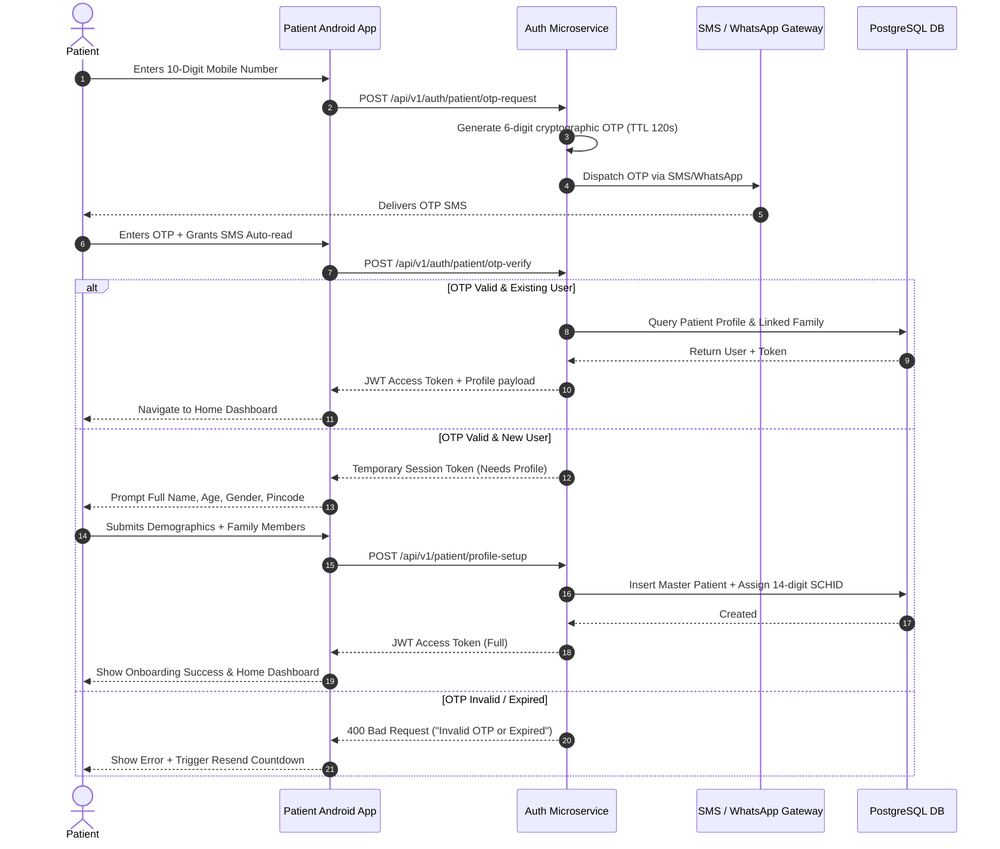
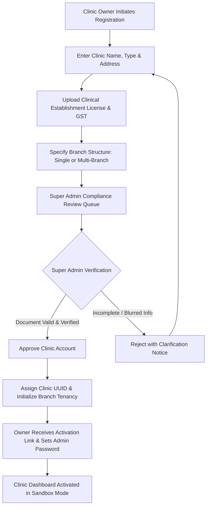
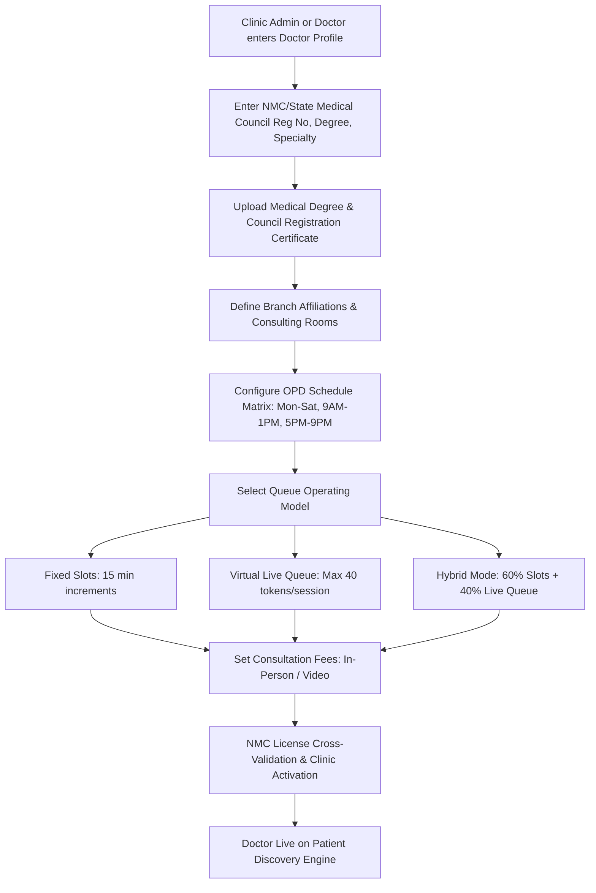
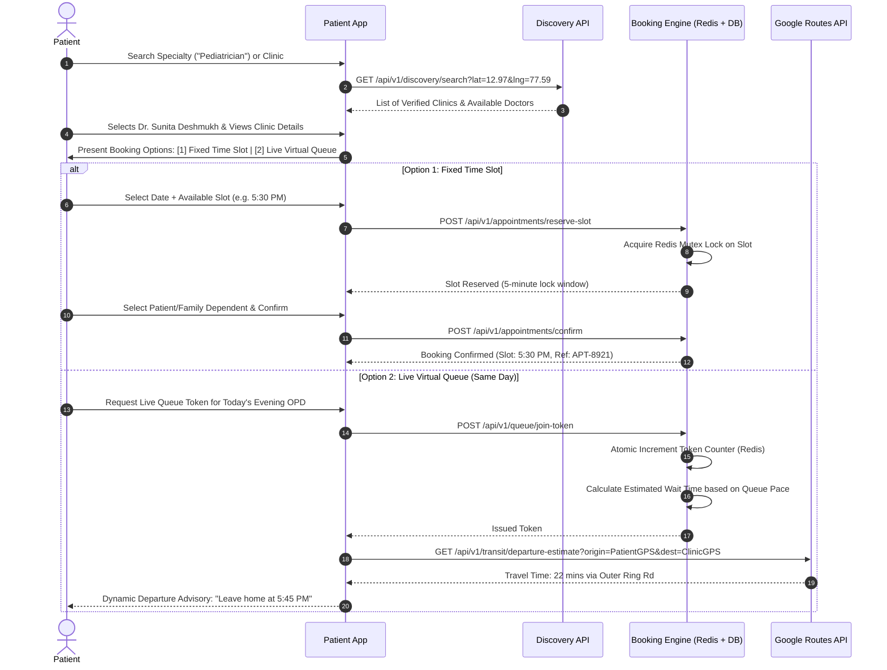
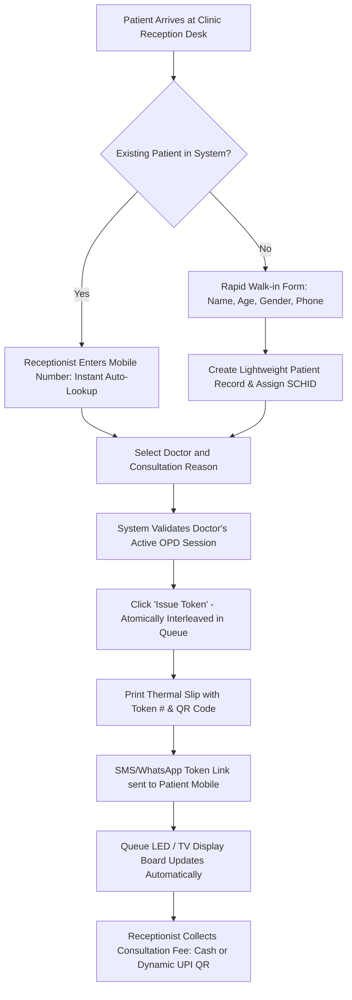
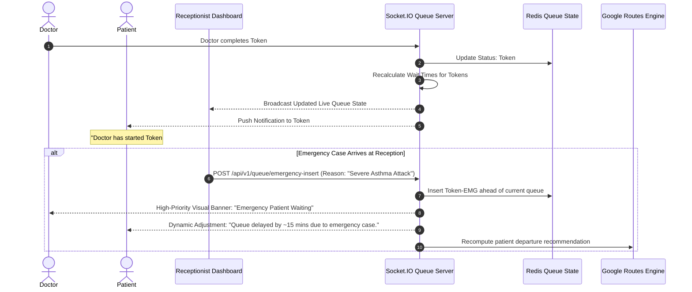
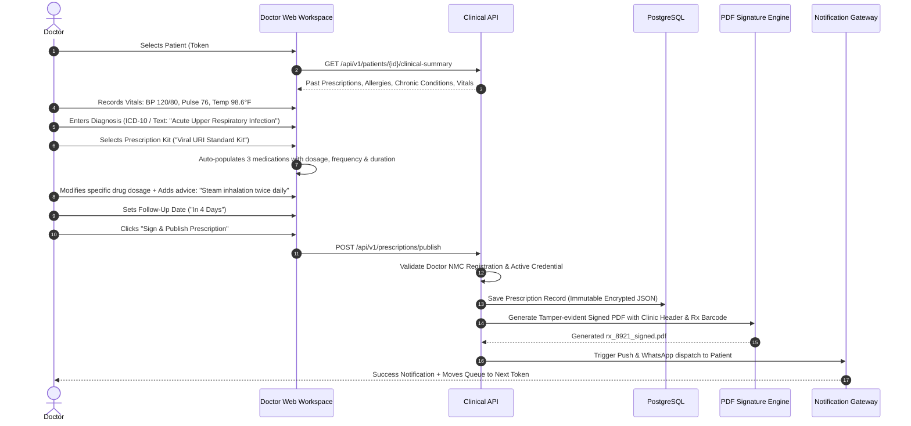
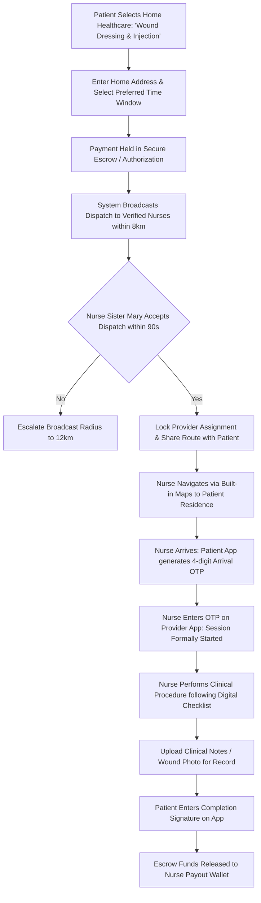
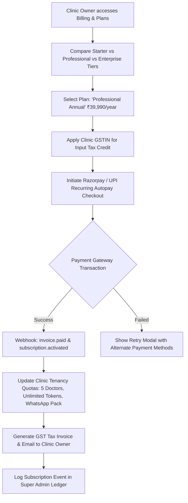

# Smart Clinic OS — End-to-End User Flows & Interaction Workflows

**Document ID:** SCO-P0-DOC-004  
**Version:** 1.0.0 (Phase 0 Deliverable)  
**Standard:** Mermaid Flowchart & Sequence Diagram Specifications  

---

## 1. Flow Index & Architecture

This document formalizes the ten foundational operational workflows across Smart Clinic OS. Every flow accounts for normal execution ("happy path"), network anomalies, clinical edge cases, and role hand-offs.

1. **Flow 1: Patient Registration & Profile Setup**
2. **Flow 2: Clinic Onboarding & Verification**
3. **Flow 3: Doctor Credentialing & Schedule Setup**
4. **Flow 4: Patient Appointment Booking (Slot vs Live Queue)**
5. **Flow 5: Receptionist Walk-in Registration & Token Generation**
6. **Flow 6: Real-Time Queue Management & Dynamic Waiting Time**
7. **Flow 7: Doctor Consultation Workspace & Clinical Examination**
8. **Flow 8: Digital Prescription Authoring & Publishing**
9. **Flow 9: Home Healthcare Provider Dispatch & Service Delivery**
10. **Flow 10: Clinic SaaS Plan Subscription & Billing Renewal**

---

## 2. Detailed Workflows

### Flow 1: Patient Registration & Profile Setup

---

### Flow 2: Clinic Onboarding & Verification

---

### Flow 3: Doctor Credentialing & Schedule Setup

---

### Flow 4: Patient Appointment Booking (Hybrid: Slot vs Live Queue)

---

### Flow 5: Receptionist Walk-in Registration & Token Generation

---

### Flow 6: Real-Time Queue Management & Dynamic Waiting Time

---

### Flow 7 & 8: Doctor Consultation Workspace & Prescription Publishing

---

### Flow 9: Home Healthcare Provider Dispatch & Service Delivery

---

### Flow 10: Clinic SaaS Plan Subscription & Billing Renewal

