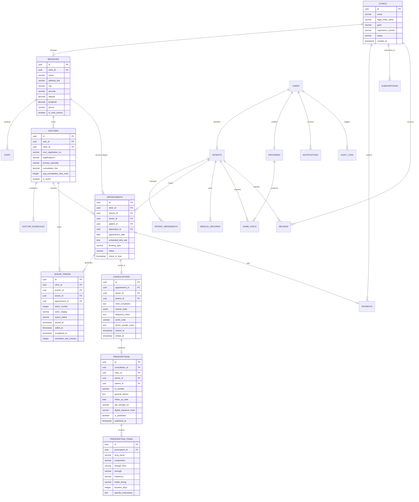

# Smart Clinic OS — Database Schema & Data Architecture

**Document ID:** SCO-P0-DOC-006  
**Version:** 1.0.0 (Phase 0 Deliverable)  
**Database Engine:** PostgreSQL 16+ with PostGIS Extension  
**Isolation Model:** Multi-Tenant Shared Schema with Row-Level Security (RLS)  

---

## 1. Entity-Relationship Diagram (Mermaid)



---

## 2. Table Specifications & Core Invariants

### 2.1 Identity & Master Entities

#### `users`
Central authentication table for all personas (patients, doctors, receptionists, owners, providers, super admins).
- `id`: `UUID PRIMARY KEY DEFAULT gen_random_uuid()`
- `mobile_number`: `VARCHAR(15) UNIQUE NOT NULL`
- `email`: `VARCHAR(255) UNIQUE`
- `password_hash`: `VARCHAR(255)` (Nullable for OTP-only patients)
- `role`: `VARCHAR(32) NOT NULL` CHECK (`role IN ('PATIENT', 'DOCTOR', 'RECEPTIONIST', 'CLINIC_OWNER', 'HOME_PROVIDER', 'SUPER_ADMIN')`)
- `is_verified`: `BOOLEAN DEFAULT FALSE`
- `created_at`: `TIMESTAMPTZ DEFAULT NOW()`

#### `clinics` & `branches`
Multi-tenant organizational structure.
- `clinics.id`: `UUID PRIMARY KEY`
- `branches.clinic_id`: `UUID REFERENCES clinics(id) ON DELETE CASCADE`
- `branches.geo_point`: `geography(Point, 4326)` for spatial distance calculations.

#### `patients` & `patient_dependents`
- `patients.id`: `UUID PRIMARY KEY`
- `patients.schid`: `VARCHAR(14) UNIQUE NOT NULL` (Format: `SCH-YYYY-XXXXXX`)
- `patients.abha_id`: `VARCHAR(20) UNIQUE`
- `patient_dependents.patient_id`: `UUID REFERENCES patients(id) ON DELETE CASCADE`
- `patient_dependents.relationship`: `VARCHAR(32) NOT NULL` (e.g., 'CHILD', 'PARENT', 'SPOUSE')

---

### 2.2 Operational Scheduling & Live Queue

#### `appointments`
Tracks both Fixed Slot and Live Virtual Queue bookings.
- `id`: `UUID PRIMARY KEY`
- `clinic_id`: `UUID NOT NULL REFERENCES clinics(id)`
- `branch_id`: `UUID NOT NULL REFERENCES branches(id)`
- `doctor_id`: `UUID NOT NULL REFERENCES doctors(id)`
- `patient_id`: `UUID NOT NULL REFERENCES patients(id)`
- `booking_type`: `VARCHAR(20) NOT NULL CHECK (booking_type IN ('FIXED_SLOT', 'LIVE_QUEUE', 'WALK_IN'))`
- `status`: `VARCHAR(24) NOT NULL CHECK (status IN ('BOOKED', 'CHECKED_IN', 'IN_CONSULTATION', 'COMPLETED', 'CANCELLED', 'NO_SHOW'))`
- `appointment_date`: `DATE NOT NULL`
- `scheduled_time_slot`: `TIME` (Nullable for Live Queue tokens)

#### `queue_tokens`
Real-time state table for daily OPD queuing.
- `id`: `UUID PRIMARY KEY`
- `clinic_id`: `UUID NOT NULL`
- `branch_id`: `UUID NOT NULL`
- `doctor_id`: `UUID NOT NULL`
- `token_number`: `INTEGER NOT NULL`
- `token_display`: `VARCHAR(16) NOT NULL` (e.g., `TKN-014` or `EMG-001`)
- `queue_status`: `VARCHAR(24) NOT NULL CHECK (queue_status IN ('WAITING', 'CALLED', 'IN_CABIN', 'COMPLETED', 'SKIPPED', 'CANCELLED'))`
- `is_emergency`: `BOOLEAN DEFAULT FALSE`
- `emergency_reason`: `TEXT`
- **Unique Constraint:** `UNIQUE (doctor_id, appointment_date, token_number)`

---

### 2.3 Clinical Records & Medical Vault

#### `consultations` & `prescriptions`
- `prescriptions.rx_number`: `VARCHAR(32) UNIQUE NOT NULL`
- `prescriptions.digital_signature_hash`: `VARCHAR(128) NOT NULL` (SHA-256 of payload signed by doctor key)
- `prescriptions.is_published`: `BOOLEAN DEFAULT FALSE` (Only published prescriptions are visible to patient)

#### `medical_records`
- `id`: `UUID PRIMARY KEY`
- `patient_id`: `UUID NOT NULL REFERENCES patients(id)`
- `record_type`: `VARCHAR(32) CHECK (record_type IN ('PRESCRIPTION', 'LAB_REPORT', 'SCAN_IMAGING', 'DISCHARGE_SUMMARY'))`
- `file_url`: `TEXT NOT NULL`
- `file_encryption_key_id`: `VARCHAR(64)`
- `ocr_extracted_data`: `JSONB`

---

### 2.4 SaaS Subscriptions & Payments

#### `subscriptions`
- `id`: `UUID PRIMARY KEY`
- `clinic_id`: `UUID NOT NULL REFERENCES clinics(id)`
- `plan_tier`: `VARCHAR(32) CHECK (plan_tier IN ('STARTER', 'PROFESSIONAL', 'ENTERPRISE'))`
- `billing_cycle`: `VARCHAR(16) CHECK (billing_cycle IN ('MONTHLY', 'ANNUAL'))`
- `current_period_end`: `TIMESTAMPTZ NOT NULL`
- `is_active`: `BOOLEAN DEFAULT TRUE`

#### `payments`
- `id`: `UUID PRIMARY KEY`
- `clinic_id`: `UUID NOT NULL REFERENCES clinics(id)`
- `amount_paise`: `BIGINT NOT NULL`
- `payment_method`: `VARCHAR(20) CHECK (payment_method IN ('CASH', 'UPI', 'CARD', 'NETBANKING'))`
- `razorpay_payment_id`: `VARCHAR(64)`
- `gst_invoice_number`: `VARCHAR(32) UNIQUE`

---

### 2.5 Home Healthcare & Provider Gigs

#### `providers` & `home_visits`
- `providers.council_registration_number`: `VARCHAR(64) UNIQUE NOT NULL`
- `providers.service_types`: `TEXT[] NOT NULL` (e.g. `{'NURSING', 'PHYSIOTHERAPY', 'ELDER_CARE'}`)
- `providers.payout_upi_id`: `VARCHAR(64) NOT NULL`
- `home_visits.arrival_otp`: `VARCHAR(6) NOT NULL`
- `home_visits.status`: `VARCHAR(24) CHECK (status IN ('REQUESTED', 'ASSIGNED', 'EN_ROUTE', 'IN_SERVICE', 'COMPLETED', 'CANCELLED'))`

---

## 3. High-Performance Indexing Strategy

```sql
-- 1. Real-time Queue Lookup Performance
CREATE INDEX idx_queue_lookup ON queue_tokens (clinic_id, doctor_id, queue_status, token_number);

-- 2. Appointment Search & Prevention of Double Booking
CREATE INDEX idx_appointment_doctor_date ON appointments (doctor_id, appointment_date, scheduled_time_slot) 
  WHERE status NOT IN ('CANCELLED');

-- 3. Geo-Spatial Clinic & Doctor Discovery
CREATE INDEX idx_branches_geo ON branches USING GIST (geo_point);

-- 4. Patient Fast History Retrieval
CREATE INDEX idx_consultations_patient ON consultations (patient_id, created_at DESC);
CREATE INDEX idx_prescriptions_patient ON prescriptions (patient_id, published_at DESC);

-- 5. Audit Logging Speed
CREATE INDEX idx_audit_clinic_time ON audit_logs (clinic_id, created_at DESC);
```

---

## 4. Multi-Tenant Row-Level Security (RLS) Policy Implementations

```sql
-- Enable RLS across tenant-bound tables
ALTER TABLE appointments ENABLE ROW LEVEL SECURITY;
ALTER TABLE queue_tokens ENABLE ROW LEVEL SECURITY;
ALTER TABLE consultations ENABLE ROW LEVEL SECURITY;
ALTER TABLE prescriptions ENABLE ROW LEVEL SECURITY;
ALTER TABLE payments ENABLE ROW LEVEL SECURITY;

-- Standard tenant policy
CREATE POLICY tenant_isolation_appointments ON appointments
  FOR ALL
  TO clinic_user
  USING (clinic_id = current_setting('app.current_clinic_id')::uuid);

CREATE POLICY tenant_isolation_queue ON queue_tokens
  FOR ALL
  TO clinic_user
  USING (clinic_id = current_setting('app.current_clinic_id')::uuid);
```

---

## 5. Data Retention & Archival Policies
- **Queue Tokens:** Partitioned by month. Active queues held in Redis and PostgreSQL master; records older than 180 days migrated to read-only cold partitions.
- **Clinical Records:** Retained for a minimum of 7 years in accordance with Indian Medical Council (Professional Conduct, Etiquette and Ethics) Regulations, 2002.
- **Audit Logs:** Immutable write-only append logs retained for 5 years for legal compliance.
