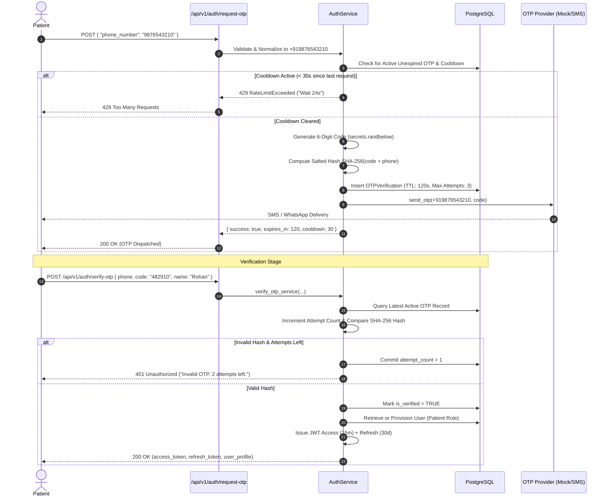

# Smart Clinic OS — Authentication Flow & Security Architecture

**Document ID:** SCO-P1-AUTH-001  
**Version:** 1.0.0 (Phase 1 Baseline)  
**Standard:** NIST SP 800-63B / OWASP Authentication Best Practices  

---

## 1. Authentication Mechanisms

Smart Clinic OS operates a dual authentication system tailored for Indian healthcare realities:
1. **Primary Patient & Staff Mobile Authentication:** OTP (One-Time Password) challenge-response via SMS/WhatsApp with cryptographic salted hashing.
2. **Administrative & Clinic Staff Authentication:** Bcrypt salted password authentication (`rounds=12`) with optional 2FA.

---

## 2. OTP Lifecycle & Security Invariants



---

## 3. JWT Token Model & Revocation Blacklist

### 3.1 Token Payloads
- **Access Token:**
  ```json
  {
    "sub": "user-uuid-here",
    "iat": 1794200000,
    "exp": 1794200900,
    "jti": "random-uuid-token-id",
    "type": "access",
    "phone_number": "+919876543210",
    "full_name": "Rohan Deshmukh"
  }
  ```
- **Refresh Token:**
  ```json
  {
    "sub": "user-uuid-here",
    "iat": 1794200000,
    "exp": 1796792000,
    "jti": "unique-refresh-uuid",
    "type": "refresh"
  }
  ```

### 3.2 Revocation via Redis Blocklist
Upon `POST /api/v1/auth/logout`:
1. The token's `jti` is extracted from the JWT payload.
2. The remaining seconds until expiration (`exp - now`) are computed.
3. The key `jwt_blacklist:<jti>` is set in Redis with the remaining TTL.
4. Future incoming requests containing this token fail Flask-JWT-Extended's `token_in_blocklist_loader` check and return `401 TOKEN_REVOKED`.

