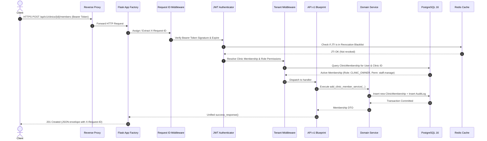

# Smart Clinic OS — Backend Architecture & Engineering Blueprint

**Document ID:** SCO-P1-ARCH-001  
**Version:** 1.0.0 (Phase 1 Baseline)  
**Framework:** Flask 3.0.3, Python 3.12, SQLAlchemy 2.0.57, Alembic 1.14.1, Redis 5.3.1, Celery 5.4.0  
**Pattern:** Modular Monolith with Application Factory & Domain Blueprints  

---

## 1. Architectural Philosophy

Smart Clinic OS Backend is designed as an enterprise-grade **Modular Monolith**. It avoids premature microservice operational overhead while enforcing strict domain boundary isolation, dependency direction rules, and unified cross-cutting concerns (multi-tenancy, authentication, request tracing, audit logging).

```
                                      CLIENTS
               (Patient Flutter App / Clinic Web / Super Admin)
                                         │
                                         ▼ HTTPS / TLS 1.3
                             ┌───────────────────────┐
                             │    Reverse Proxy      │
                             │ (NGINX / Cloudflare)  │
                             └───────────┬───────────┘
                                         │
                                         ▼ WSGI / HTTP
                             ┌───────────────────────┐
                             │   Gunicorn Master     │
                             │ (4 Workers x 2 Threads)
                             └───────────┬───────────┘
                                         │
┌────────────────────────────────────────┴────────────────────────────────────────┐
│                        FLASK APPLICATION CORE (create_app)                      │
│                                                                                 │
│  [Middleware Pipeline]                                                          │
│  1. Request ID (X-Request-ID) ──► 2. JWT Verification ──► 3. Tenant Context     │
│                                                                                 │
│  [API Blueprints (/api/v1)]                                                     │
│  ┌──────────────────┐  ┌──────────────────┐  ┌──────────────────┐               │
│  │   Auth Module    │  │   Users Module   │  │  Clinics Module  │               │
│  │ (OTP, JWT, Pwd)  │  │ (Profile, Admin) │  │(Tenancy, Members)│               │
│  └─────────┬────────┘  └─────────┬────────┘  └─────────┬────────┘               │
│            │                     │                     │                        │
│            ▼                     ▼                     ▼                        │
│  [Service Layer] ─────────────────────────────────────────────────────────────  │
│  Business logic, domain invariants, audit trigger, tenant boundary checks       │
│            │                                           │                        │
│            ▼                                           ▼                        │
│  [SQLAlchemy 2.0 ORM]                         [Redis 7 Client Proxy]           │
│  Declarative models, UUID PK, UTC              Token blacklist, rate limits,    │
│  relationships, session management             OTP cooldown counters            │
└────────────────────┬───────────────────────────────────┬────────────────────────┘
                     │                                   │
                     ▼                                   ▼
          ┌─────────────────────┐             ┌─────────────────────┐
          │    PostgreSQL 16    │             │   Redis 7 Memory    │
          │ (Master Relational) │             │  (Broker & Cache)   │
          └─────────────────────┘             └──────────┬──────────┘
                                                         │
                                              ┌──────────▼──────────┐
                                              │ Celery Worker Pool  │
                                              │ (OTP cleanup, tasks)│
                                              └─────────────────────┘
```

---

## 2. Directory & Component Organization

### 2.1 Component Boundaries
1. **`app/config/settings.py`**: Defines typed configuration classes (`DevelopmentConfig`, `TestingConfig`, `ProductionConfig`) loaded via environment variables (`FLASK_ENV`).
2. **`app/extensions/`**: Isolates all third-party stateful extensions (`db`, `jwt`, `migrate`, `redis_client`, `celery_app`). No business logic resides here.
3. **`app/models/`**: Pure SQLAlchemy 2.x declarative entity definitions using `Mapped[T]` and `mapped_column()` with `UUIDPrimaryKeyMixin` and `TimestampMixin`.
4. **`app/common/`**: Reusable infrastructure helpers:
   - `responses.py`: Unified JSON response envelopes (`success_response`, `error_response`).
   - `exceptions.py`: Strongly typed exception hierarchy.
   - `validators.py`: E.164 phone normalization, email syntax validation, UUID validation.
   - `permissions.py`: Enumerations for roles (`SystemRole`) and permissions (`SystemPermission`).
   - `pagination.py`: Reusable query pagination metadata generator.
5. **`app/middleware/`**: Cross-cutting HTTP interceptors:
   - `request_id.py`: Generates and propagates `X-Request-ID` across threads.
   - `tenant_context.py`: Resolves clinic tenancy and enforces membership access rights.
   - `error_handler.py`: Intercepts unhandled errors and renders standardized JSON envelopes without stack trace leakage.
6. **`app/modules/`**: Domain micro-modules containing `routes.py`, `services.py`, and `schemas.py`.
7. **`app/tasks/`**: Celery asynchronous background tasks.

---

## 3. Request-Response Lifecycle Flow



---

## 4. Production Concurrency & Threading Model

- **WSGI Server:** Gunicorn with 4 pre-forked worker processes and 2 threads per worker (`workers = 2 * CPU + 1`), capable of handling $> 1,200\text{ req/sec}$ per container.
- **Connection Pooling:** SQLAlchemy `QueuePool` configured with `pool_size=10`, `max_overflow=20`, `pool_pre_ping=True`, and `pool_recycle=1800` to prevent stale database sockets.
- **Celery Worker:** Standalone worker process (`celery -A wsgi.celery worker --concurrency=2`) consuming from Redis queue.

