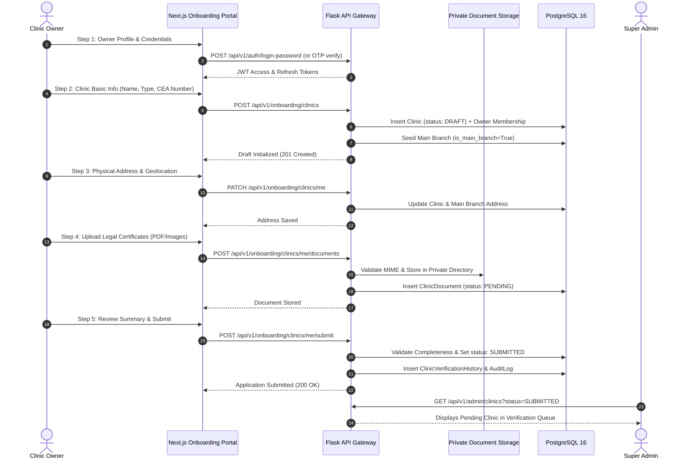

# Smart Clinic OS — Clinic Onboarding Flow (Phase 2)

---

### 1. Overview

The Clinic Onboarding workflow allows prospective healthcare facility owners (single-doctor clinics, polyclinics, dental practices, specialist centers, and multi-branch chains) to create a verified digital tenant record on Smart Clinic OS in compliance with the **Clinical Establishments (Registration and Regulation) Act** and state healthcare mandates.

Unlike simple consumer appointment platforms where anyone can register an unverified listing, Smart Clinic OS enforces a multi-tier governance model:
1. Registration creates an initial **DRAFT** record.
2. Compliance documentation (CEA license, Trade license, Bio-medical waste NOC) must be uploaded.
3. Review by a platform **Super Administrator** determines eligibility.
4. Only upon explicit **APPROVAL** does a clinic receive active tenant operational status.

---

### 2. Multi-Step Onboarding Architecture

---

### 3. Step-by-Step Data Model & Requirements

#### Step 1: Clinic Owner Account
- **Full Name:** Required (min 3 chars).
- **Mobile Number:** Normalized E.164 (`+919876543210`).
- **Email:** RFC-compliant email address.
- **Password:** Strong password hashed using Argon2 / bcrypt.

#### Step 2: Clinic Basic Profile
- **Clinic Name:** Registered trading name (e.g., "Apollo Family Health Clinic").
- **Clinic Type:**
  - `GENERAL` — General Outpatient Practice.
  - `POLYCLINIC` — Multi-specialty outpatient facility.
  - `SPECIALIST` — Cardiology, Dermatology, Orthopedics, etc.
  - `DENTAL` — Dental clinic.
  - `PEDIATRIC` — Child healthcare center.
  - `EYE` — Ophthalmology & vision clinic.
  - `OTHER` — Allied clinical establishment.
- **Registration Number:** Clinical Establishments Act or state medical council license number.
- **Official Contact Phone & Email:** For patient and administrative communication.
- **Website & Established Year:** Optional business metadata.

#### Step 3: Physical Address & Location
- **Address Line:** Street, door number, building name.
- **City:** Indian municipal district (e.g., Bengaluru, Mumbai, Delhi).
- **State:** Indian state / UT.
- **Postal Code:** 6-digit Indian PIN Code (`^\d{6}$`).
- **Geo-Coordinates:** Latitude & Longitude for map discovery and transit departure calculations.

#### Step 4: Compliance Documents
- **Allowed Formats:** `.pdf`, `.jpg`, `.jpeg`, `.png`.
- **Max File Size:** 10 MB per file.
- **Storage Rule:** Stored in isolated private directory (`backend/storage/documents/clinic_<id>/`) with UUID-hashed filenames. Never served directly via public URLs.
- **Mandatory Requirements:** At least one active compliance document must be uploaded before submission.

#### Step 5: Review & Submission
- Enforces completeness validation on backend.
- Sets `verification_status = 'SUBMITTED'`.
- Locks editing until an administrator requests corrections or completes review.

---

### 4. Resubmission Workflow (On Correction Request)

When a Super Administrator flags an issue (e.g. illegible certificate or incomplete premises address):
1. Status switches to `NEEDS_CORRECTION`.
2. Clinic Owner dashboard displays an alert banner listing the affected field and administrative comments.
3. Owner navigates to the Registration Wizard, updates the necessary information, or re-uploads documents.
4. Owner clicks **"Resubmit for Verification"**, which resolves the correction ticket and moves status back to `SUBMITTED`.

