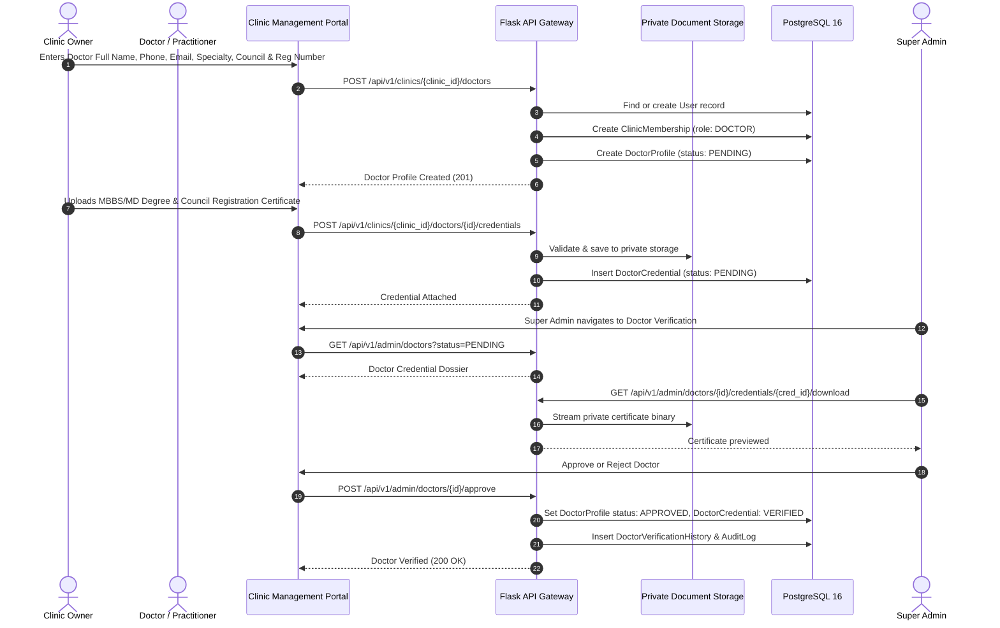

# Smart Clinic OS — Doctor Onboarding & Verification Workflow (Phase 2)

---

### 1. Overview & Regulatory Mandate

Under the **National Medical Commission (NMC) Act 2019** and the **Telemedicine Practice Guidelines 2020**, only practitioners registered with the National Medical Commission or an applicable State Medical Council (e.g. Karnataka Medical Council, Maharashtra Medical Council) may legally consult and prescribe medications in India.

Phase 2 establishes the database foundation, secure credential document upload, and administrative verification workflow for doctors.

---

### 2. Onboarding Workflow

---

### 3. Doctor Verification States

1. `PENDING` — Doctor profile created; credential certificates uploaded and awaiting administrative audit.
2. `UNDER_REVIEW` — Administrator is inspecting qualifications and council registration records.
3. `APPROVED` — Qualifications, registration council, and license number verified. Eligible for branch scheduling and patient consultation.
4. `NEEDS_CORRECTION` — Clarification required on registration council or certificate.
5. `REJECTED` — Credentials rejected due to license mismatch or illegible document.
6. `SUSPENDED` — Temporarily barred from practicing on the platform.

---

### 4. Branch Consultation Scheduling Foundation

During Phase 2 onboarding, verified doctors can be mapped to one or more clinic branches with defined consultation hours:
- `branch_id` — Associated physical clinic facility.
- `day_of_week` — 0 (Monday) through 6 (Sunday).
- `start_time` & `end_time` — Consultation window (e.g. `09:00` - `13:00`).
- `is_available` — Operational toggle.

