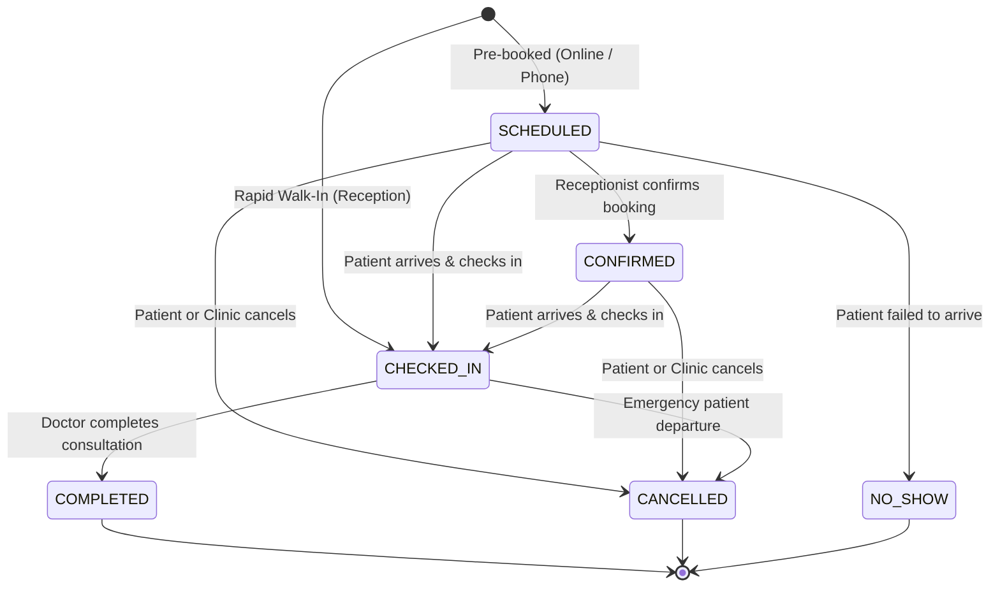

# Smart Clinic OS — Appointment Foundation & Scheduling Engine
**Phase 3 Deliverable • Indian Healthcare SaaS Platform**

---

## 1. Unified Appointment Architecture

In traditional clinic software, scheduled appointments and walk-in patients are stored in separate tables or ad-hoc lists, creating race conditions, fragmented billing, and impossible queue tracking.

Smart Clinic OS establishes a **Unified Appointment Entity** (`appointments`) that powers:
1. Pre-booked online appointments.
2. Reception telephonic bookings.
3. Physical walk-in patient visits.
4. Future Phase 4 live WebSocket queue tokens.

Walk-in patients are represented as standard `Appointment` records with `appointment_source = 'WALK_IN'` and initial status `CHECKED_IN`, ensuring 100% architectural uniformity.

---

## 2. Appointment Lifecycle & State Machine



### State Definitions:
- `SCHEDULED`: Booking created for a future date/time slot.
- `CONFIRMED`: Patient or clinic confirmed intent to attend.
- `CHECKED_IN`: Patient has physically reported to clinic reception; waiting room queue position assigned; `checked_in_at` timestamp recorded.
- `COMPLETED`: Doctor has finished clinical examination, drafted notes, and discharged patient; `completed_at` timestamp recorded.
- `CANCELLED`: Appointment cancelled with mandatory documented reason.
- `NO_SHOW`: Slot elapsed without patient arrival.

---

## 3. Transactional Concurrency & Overlap Prevention

A primary challenge in outpatient booking is double-booking: two receptionists or an online patient concurrently booking the same doctor for the same time slot.

Smart Clinic OS prevents double bookings at the PostgreSQL database transaction level via row-level locking:
```python
# Concurrency & Overlap check: Lock matching doctor schedule row
overlap = db.session.scalar(
    select(Appointment).where(
        Appointment.doctor_id == doctor.id,
        Appointment.appointment_date == appt_date,
        Appointment.appointment_time == appt_time,
        Appointment.status.notin_(["CANCELLED", "NO_SHOW"])
    ).with_for_update()
)
if overlap:
    raise ConflictError(
        f"Doctor '{doctor.doctor_name}' already has an active appointment at {appt_date} {appt_time}"
    )
```

- If an active booking exists, a `409 Conflict` HTTP error is returned immediately with a clear message.
- Transactions are ACID-compliant and protected against concurrent multi-user write races.

---

## 4. Consultation Notes Drafting Subsystem

Attached to each consultation is a dedicated 1-to-1 medical notes record: `ConsultationNote` (`consultation_notes` table):
- `appointment_id`: FK `appointments.id` (CASCADE, UNIQUE).
- `doctor_id`: FK `doctor_profiles.id`.
- `symptoms`: Text field capturing chief complaints.
- `clinical_notes`: Text field capturing examination, vitals, and physical findings.
- `diagnosis_summary`: Provisional diagnosis with ICD-10 notation.
- `follow_up_date`: Optional date for next clinical review.
- `follow_up_notes`: Doctor's advice and medication notes.
- `is_draft`: Boolean flag indicating whether consultation notes are in progress or finalized.

Doctors can repeatedly save drafts via `PUT /api/v1/clinic/appointments/<id>/notes` without premature visit closure.

