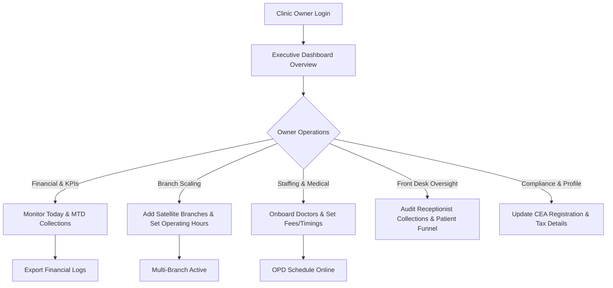

# Smart Clinic OS — Clinic Owner Workflow & Executive Operations
**Phase 3 Deliverable • Indian Healthcare SaaS Platform**

---

## 1. Executive Summary & Role Mandate

In the Indian outpatient healthcare ecosystem, clinic owners range from single doctor-proprietors running individual clinics to non-medical healthcare entrepreneurs managing multi-specialty polyclinics and multi-branch clinic chains.

The **Clinic Owner** role in Smart Clinic OS provides an executive control center designed to:
1. Provide real-time operational oversight across branches, doctors, and front-desk reception counters.
2. Track financial collections (cash, UPI, cards) and monitor MTD revenue without accounting lag.
3. Supervise doctor staffing, credentials, consultation durations, and fee tiers.
4. Govern branch capacity, operating schedules, and multi-location expansion.
5. Ensure regulatory compliance with the Clinical Establishments Act and the Digital Personal Data Protection (DPDP) Act 2023.

---

## 2. Key Executive Interfaces & Metrics

### 2.1 Operational KPIs & Financial Analytics
Located at `/clinic` (Executive Tab) and backed by `GET /api/v1/clinic/dashboard/overview`:
- **Today's Collections (₹):** Real-time sum of append-only consultation payments collected today across all branches and doctors.
- **Monthly Revenue (MTD) (₹):** Aggregate cash flow for the calendar month to date.
- **Today's Patient Visits:** Count of scheduled, walk-in, and emergency patient visits.
- **Waiting Room Volume:** Real-time count of patients physically checked in and awaiting consultation.
- **Completed vs. Cancelled Consultations:** Real-time completion rate and cancellation monitoring.
- **Patient Volume Funnel:** Categorized breakdown across Scheduled (`SCHEDULED`, `CONFIRMED`), Checked-In (`CHECKED_IN`), Completed (`COMPLETED`), and Cancelled (`CANCELLED`).
- **Patient Arrival Channels:** Distribution of visits arriving via Walk-In front desk, Online Web/App bookings, and Telephonic intake.
- **7-Day Rolling Trend:** Day-by-day table and graphical metrics tracking volume and revenue over the past week.

### 2.2 Branch Management & Multi-Location Scaling
Accessible via the owner workspace:
- Multi-branch hierarchy linking satellite clinics to the clinic tenant.
- Designation of headquarters/main branch vs. peripheral consultation centers.
- Branch-specific operating schedules: 7-day opening hours, break times, and holiday closures.

### 2.3 Doctor Roster & Credentialing Oversight
- Real-time roster of onboarded doctors with medical registration numbers, state medical councils, and verification status.
- Configurable consultation fees (e.g. ₹500, ₹800) and slot durations (15, 20, 30 minutes).
- Association of doctors with primary practice branches and custom weekly clinical shift timings.

### 2.4 Staff Management & RBAC Permissions
- Roster of receptionists, nursing staff, and billing clerks.
- Instant role assignment (`CLINIC_OWNER`, `DOCTOR`, `RECEPTIONIST`) with zero privilege leakage across tenants.

---

## 3. End-to-End Workflow Diagram

---

## 4. Security & Tenant Boundary Enforcement
- All owner API requests require JWT authentication and an active `CLINIC_OWNER` or `SUPER_ADMIN` role.
- Tenant isolation is strictly enforced via `@require_tenant_membership`: Clinic Owners cannot inspect other clinics' revenue, patients, or schedules.
- Financial records are append-only: owners can issue adjustments/refunds via `POST /api/v1/clinic/payments/<id>/adjustments` with full audit logging, preventing silent ledger tampering.

