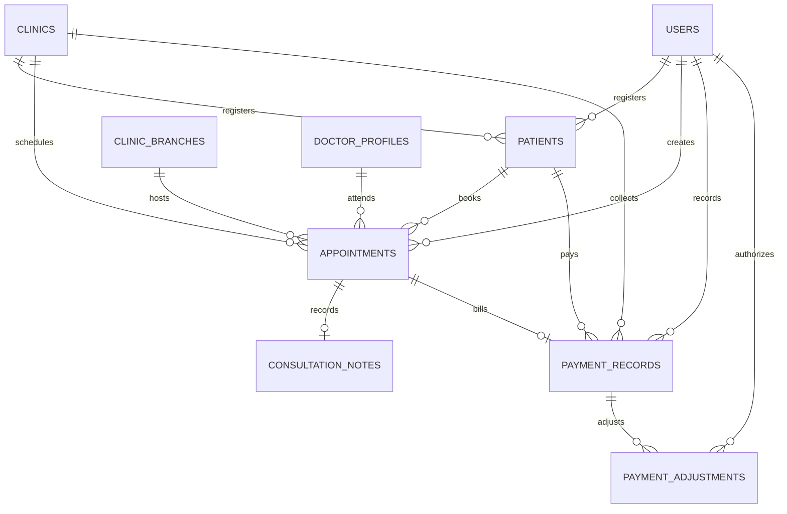

# Smart Clinic OS — Database Changes & Migration Architecture
**Phase 3 Deliverable • Indian Healthcare SaaS Platform**

---

## 1. Executive Summary

Phase 3 introduces 5 relational entities in PostgreSQL managed via Alembic:
1. `patients`
2. `appointments`
3. `consultation_notes`
4. `payment_records`
5. `payment_adjustments`

---

## 2. Alembic Migration Script

- **Migration ID:** `c24a3eb9244d`
- **Revision Title:** `phase_3_clinic_management_appointments_patients_billing`
- **Executed via:** `flask db upgrade` against PostgreSQL database `smart_clinic_os`.
- **Status:** Applied and verified with 100% test coverage.

---

## 3. Detailed Entity Relationship Architecture

---

## 4. Key Indices & Constraint Guarantees

1. **`uq_clinic_patient_phone`:**
   `UNIQUE (clinic_id, phone_number)` on `patients` table. Prevents duplicate patient registration within any clinic.
2. **`ix_appointments_doctor_date_time`:**
   Indexed for rapid lookups and row-level locking during conflict detection.
3. **`uq_payment_receipt_number`:**
   `UNIQUE (receipt_number)` on `payment_records` table.
4. **Foreign Key Integrity:**
   - Patient deletion restricted (`RESTRICT`) if appointments or payments exist.
   - Cascade deletion (`CASCADE`) cleanly purges consultation notes when an appointment is purged.

