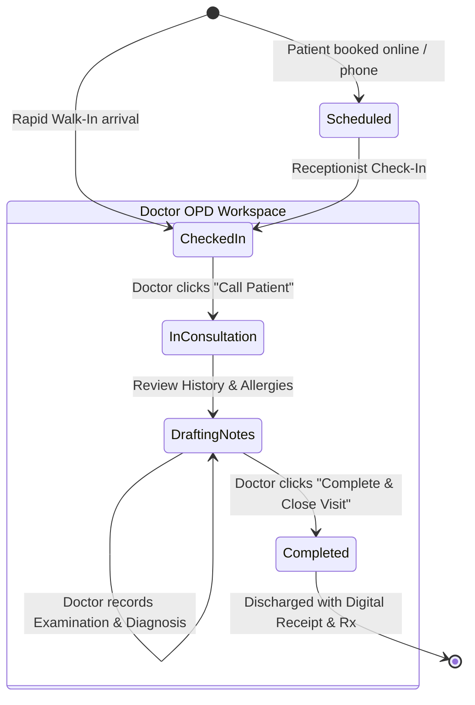

# Smart Clinic OS — Doctor Workflow & Clinical OPD Console
**Phase 3 Deliverable • Indian Healthcare SaaS Platform**

---

## 1. Executive Summary & Clinical Role

In the Indian healthcare system, outpatient doctors consult dozens of patients per shift in high-throughput environments. Doctors require a clean, distraction-free clinical console that:
1. Shows their real-time waiting room queue ordered by arrival.
2. Provides instant access to the patient's medical history, chronic conditions, and drug allergies without hunting through paper files.
3. Allows rapid drafting and saving of chief complaints, clinical examination findings, provisional diagnoses (with ICD-10 notation), and advice.
4. Marks consultations completed with an immutable timestamp.

---

## 2. Doctor OPD Console Features

### 2.1 Doctor Header & Credential Verification
- Displays doctor's full legal name, qualifications (e.g. MBBS, MD), specialty, registration council (e.g. Karnataka Medical Council), and registration license number.
- In multi-doctor clinics, allows owners and administrators to review individual doctor queues via the doctor switcher.

### 2.2 Live Waiting Room Queue
- Displays all patients currently checked in and waiting in the waiting room specifically for this doctor.
- Each queue card highlights:
  - Queue sequence position (`Queue #1`, `Queue #2`, etc.).
  - Check-in arrival time.
  - Patient Full Name, Phone Number, Age, and Gender.
  - Reason for visit / presenting complaint recorded at intake.
- **"Call Patient" Action:** Actively brings the selected patient into the active consultation workspace.

### 2.3 Patient Medical History & DPDP Scoping
- Instant visibility into:
  - **Blood Group** (e.g., `O+`, `B+`).
  - **Known Drug Allergies** (e.g., `Penicillin`, `Sulfa drugs`) — prominently highlighted to prevent adverse drug events.
  - **Chronic Conditions** (e.g., `Hypertension`, `Type-2 Diabetes`).
  - **Total Past Visits** to this clinic.

### 2.4 Clinical Consultation Notes Studio
Structured medical notes editor supporting rapid clinical documentation:
- **Chief Complaints & Presenting Symptoms:** Duration, onset, severity (e.g., High-grade fever for 3 days with dry cough).
- **Clinical Examination & Vitals Findings:** Physical examination notes, blood pressure, pulse, chest auscultation, throat examination.
- **Provisional Diagnosis / ICD-10:** Clinical diagnosis summary.
- **Follow-up & Advice:** Lifestyle modifications, hydration advice, review date.
- **Save Draft:** Stores drafts via `PUT /api/v1/clinic/appointments/<id>/notes` allowing iterative documentation during physical examination.

### 2.5 Complete Consultation & Patient Discharge
- One-click **"Complete & Close Visit"** button:
  - Automatically saves the latest clinical notes draft.
  - Calls `POST /api/v1/clinic/appointments/<id>/complete`.
  - Sets appointment status to `COMPLETED`.
  - Stamps exact `completed_at` UTC timestamp.
  - Clears the consultation workspace, ready for the next patient.
  - Automatically moves the patient to the "Completed Today" list.

---

## 3. Clinical Workflow Diagram

---

## 4. Medical Confidentiality & Security
- Clinical notes are tenant-isolated and stored securely in `consultation_notes`.
- Medical notes drafting requires `consultation.create` and consultation reading requires `consultation.view`.
- Non-clinical staff (receptionists, billing clerks) cannot view confidential clinical notes or doctor examination text.
- Full audit log recorded for clinical note updates and consultation completions.

