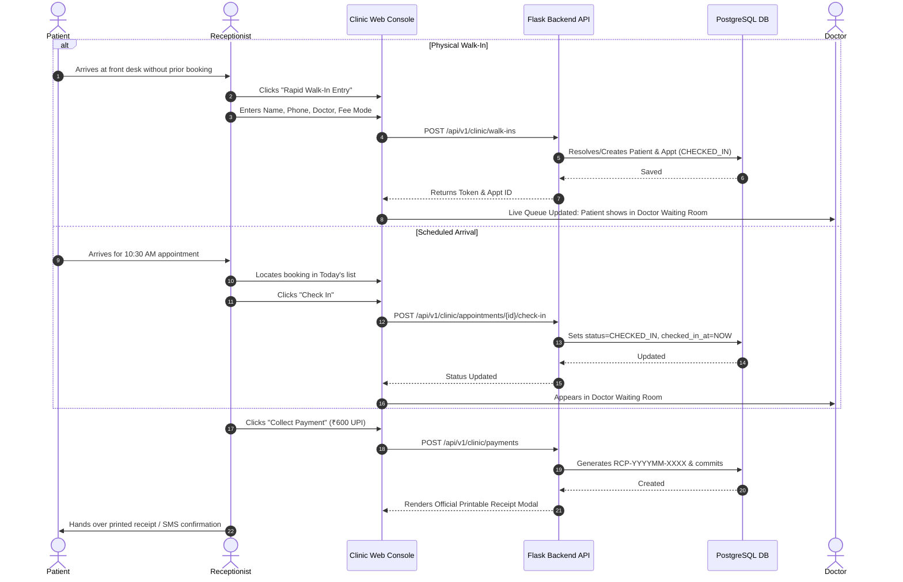

# Smart Clinic OS — Receptionist Workflow & Front Desk Operations
**Phase 3 Deliverable • Indian Healthcare SaaS Platform**

---

## 1. Executive Summary & Front-Desk Role

In Indian outpatient healthcare, the reception desk is the high-velocity operational core. Receptionists handle incoming phone calls, physical walk-in queues, cash and UPI fee collection, patient identification, token issuance, and doctor schedule adjustments.

The **Receptionist** workspace in Smart Clinic OS provides an ergonomic, high-speed front-desk console designed to minimize patient check-in bottlenecks, prevent duplicate registrations, and issue instant GST-compliant digital receipts.

---

## 2. Core Front-Desk Operations

### 2.1 Rapid Walk-In Entry (Sub-60 Second Intake)
- **High-Velocity Modal:** Receptionist inputs Patient Full Name, Phone Number, Gender, Selects Doctor, Branch, Fee, and Notes.
- **Automated Pipeline:**
  1. Checks if patient already exists in clinic database by E.164 phone number.
  2. If new, creates `Patient` record automatically.
  3. Creates `Appointment` record with `appointment_source = 'WALK_IN'`, current timestamp, and initializes status directly to `CHECKED_IN`.
  4. Patient immediately appears in the Doctor's waiting queue with zero delay.

### 2.2 Pre-Booked Appointment Management & Check-In
- Shows all appointments scheduled for today across all clinic doctors.
- Status filters: All Today, Waiting (Checked In), Scheduled (Upcoming), Completed.
- One-click **"Check In"** action:
  - Transition status from `SCHEDULED` to `CHECKED_IN`.
  - Automatically stamps `checked_in_at` with UTC timestamp.
  - Updates waiting room counters in real time.

### 2.3 Patient Directory & Duplicate Prevention
- Comprehensive patient search by mobile number (last 4 to 10 digits) or name prefix.
- Enforces strict unique constraint on `(clinic_id, phone_number)`: prevents duplicate records when patients re-visit under varying name spellings.
- Patient intake records demographic details, blood group, emergency contact numbers, known drug allergies, and chronic conditions.

### 2.4 Cash Desk Billing & Printable Digital Receipts
- Receptionist collects consultation fees using multiple payment modes:
  - **UPI / QR Code:** Input optional UPI transaction reference / UTR.
  - **Cash Counter:** Instant cash ledger entry.
  - **Card / POS:** Card transaction auth code.
- Generates sequential, tamper-evident receipt number format: `RCP-YYYYMM-XXXX`.
- **Instant Printable Receipt:** Displays clinic name, registration council, attending doctor, patient name/phone, date/time, and fees with one-click browser print support (`window.print()`).

### 2.5 Appointment Cancellation
- Receptionist can cancel scheduled visits if patient calls to cancel or requests rescheduling.
- Enforces mandatory `cancellation_reason` text logging for audit and clinic records.

---

## 3. Receptionist Front-Desk Workflow

---

## 4. Key Security & Operational Controls
- Receptionists have role `RECEPTIONIST` with permissions: `patient.create`, `patient.view`, `patient.update`, `appointment.create`, `appointment.view`, `appointment.update`, `queue.manage`, `billing.create`, `billing.view`.
- Receptionists **cannot** inspect confidential medical consultation notes or alter doctor clinical diagnoses.
- Cross-clinic access is completely blocked at the database and middleware layers.

