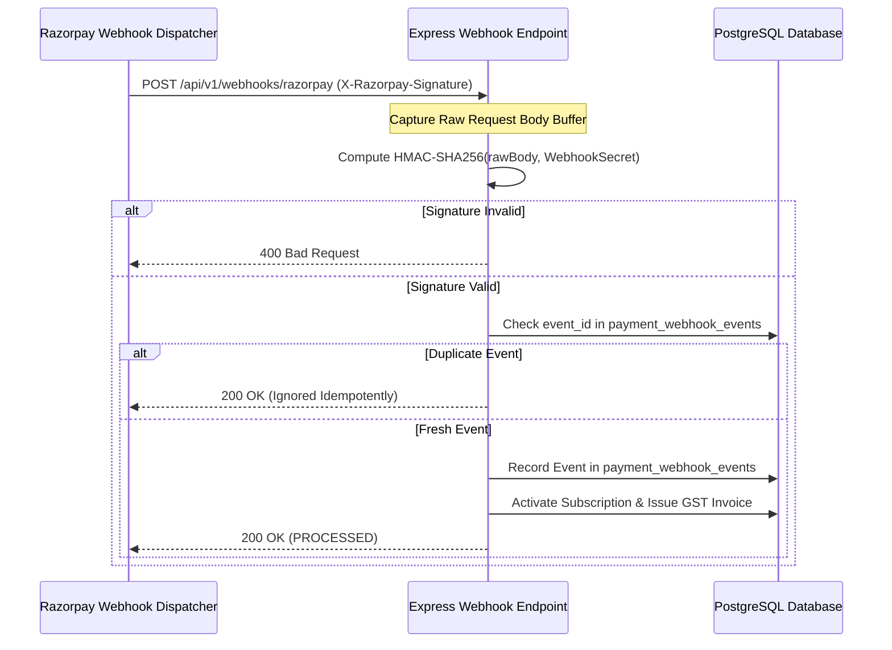

# SMART CLINIC OS — PHASE 8 RAZORPAY WEBHOOKS
## Webhook Security, Event Handling & Idempotency Engine

---

## 1. Webhook Architectural Overview

Webhooks provide asynchronous, authoritative status updates from Razorpay to Smart Clinic OS. Even if a clinic owner experiences a network failure during browser checkout, webhooks ensure guaranteed delivery and zero lost payments.



---

## 2. Raw Body Capture in Express

To verify HMAC-SHA256 signatures, the exact unmodified raw byte stream sent by Razorpay must be captured:

```javascript
app.use(express.json({
  limit: '10mb',
  verify: (req, res, buf) => {
    req.rawBody = buf;
  }
}));
```

---

## 3. Strict Event Idempotency

Network retries by payment gateways frequently deliver the same event multiple times. Table `payment_webhook_events` maintains a unique constraint on `event_id`:

```sql
CREATE TABLE IF NOT EXISTS payment_webhook_events (
  id UUID PRIMARY KEY,
  gateway VARCHAR(30) DEFAULT 'RAZORPAY',
  event_id VARCHAR(100) UNIQUE NOT NULL,
  event_type VARCHAR(100) NOT NULL,
  payload JSONB NOT NULL,
  status VARCHAR(20) DEFAULT 'PROCESSED',
  processed_at TIMESTAMPTZ DEFAULT NOW(),
  created_at TIMESTAMPTZ DEFAULT NOW()
);
```

When a duplicate event arrives, `RazorpayService.processWebhookEvent` returns `{ duplicate: true }`, returning `HTTP 200` to acknowledge the gateway while avoiding duplicate activations or invoices.

---

## 4. Supported Event Types

1. `payment.captured` & `order.paid`:
   - Extracts `clinic_id`, `plan_id`, and `billing_interval` from payment metadata notes.
   - Activates or renews the clinic subscription.
   - Generates sequential GST invoice (`INV-YYYYMM-XXXX`) and PDF.
2. `payment.failed`:
   - Logs payment failure to audit logs.
   - Triggers clinic grace period workflow without immediately locking medical records.

