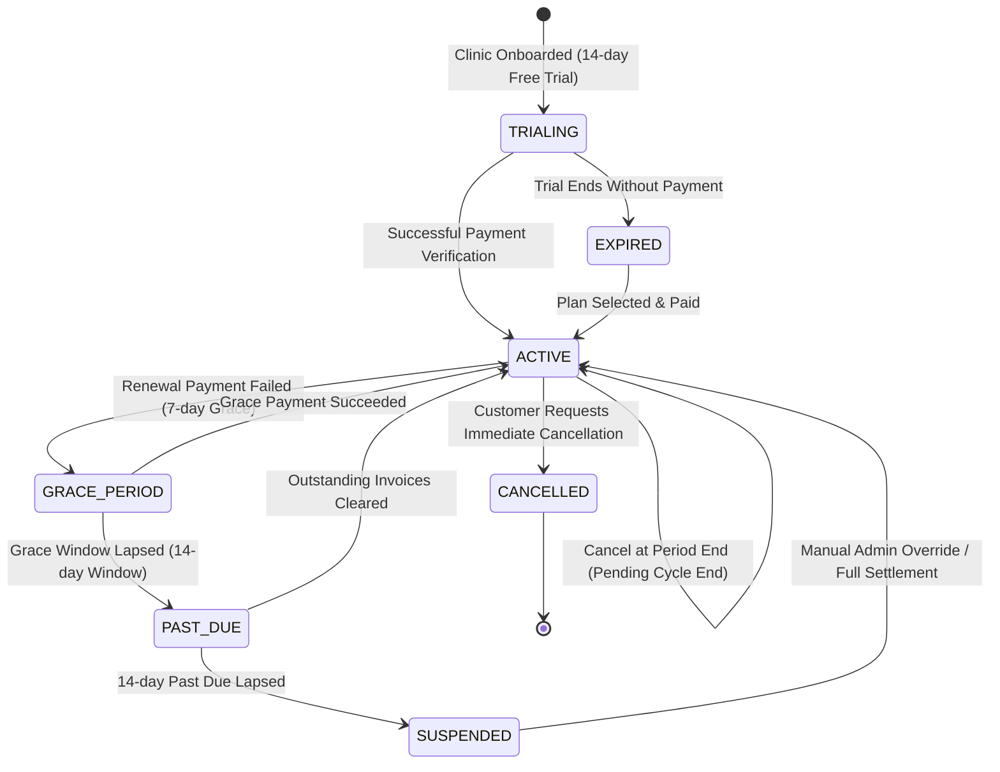

# SMART CLINIC OS — PHASE 8 SUBSCRIPTION ARCHITECTURE
## Multi-Tenant SaaS Subscription Engine & Lifecycle State Machine

---

## 1. Architectural Overview

The Smart Clinic OS subscription engine provides automated lifecycle management, tier upgrades, recurring billing, and access gating across multi-tenant clinical organizations.



---

## 2. Subscription States & Operational Rules

| State | Medical Records Access | OPD Queue & Walk-ins | Staff Additions | Patient Notifications | Gating Action |
|:---|:---:|:---:|:---:|:---:|:---|
| `TRIALING` | Full Access | Full Access | Within Tier Limits | Active | Free evaluation for 14 days |
| `ACTIVE` | Full Access | Full Access | Within Tier Limits | Active | Normal operation |
| `GRACE_PERIOD` | Full Access | Full Access | Gated | Active | Warning banner shown in portal |
| `PAST_DUE` | Read-Only Access | Blocked | Blocked | Suspended | Restricts queue check-in |
| `SUSPENDED` | Read-Only Access | Blocked | Blocked | Suspended | High-priority settlement required |
| `CANCELLED` | Read-Only Access | Blocked | Blocked | Suspended | Subscription terminated |
| `EXPIRED` | Read-Only Access | Blocked | Blocked | Suspended | Evaluation ended |

---

## 3. Database Schema

### Table: `subscription_plans`
Stores pricing, capacity limits, and feature entitlements for each SaaS tier.
- `id` (UUID PK): Unique identifier.
- `code` (VARCHAR 50 UNIQUE): `TRIAL`, `BASIC`, `PRO`, `ENTERPRISE`.
- `monthly_price` (NUMERIC 10,2): Base price per calendar month.
- `yearly_price` (NUMERIC 10,2): Discounted base price per calendar year.
- `max_branches` (INT): Branch limit (-1 = unlimited).
- `max_doctors` (INT): Doctor limit (-1 = unlimited).
- `max_staff` (INT): Staff limit (-1 = unlimited).
- `max_monthly_appointments` (INT): Appointment limit (-1 = unlimited).
- `feature_entitlements` (JSONB): Feature gate flags.

### Table: `clinic_subscriptions`
Tracks live subscription state for each clinic tenant.
- `id` (UUID PK): Unique subscription instance ID.
- `clinic_id` (UUID FK): References `clinics.id` (1 active subscription per clinic).
- `plan_id` (UUID FK): References `subscription_plans.id`.
- `status` (VARCHAR 30): State machine status.
- `billing_interval` (VARCHAR 20): `MONTHLY` or `YEARLY`.
- `current_period_start` (TIMESTAMPTZ): Beginning of active paid cycle.
- `current_period_end` (TIMESTAMPTZ): Scheduled end of billing cycle.
- `grace_period_ends_at` (TIMESTAMPTZ): Grace period expiration timestamp.
- `cancelled_at` (TIMESTAMPTZ): Timestamp when cancellation was triggered.
- `cancel_at_period_end` (BOOLEAN): Flag if cancellation occurs at cycle end.

---

## 4. Entitlement Checking Logic

Resource creation endpoints query `SubscriptionService.checkEntitlement(clinicId, featureKey, requestedAmount)`:
```javascript
// Branch creation check:
const branchEnt = await SubscriptionService.checkEntitlement(req.clinicId, 'MAX_BRANCHES', 1);
if (!branchEnt.allowed) {
  return res.status(403).json({
    success: false,
    error: {
      code: 'PLAN_LIMIT_EXCEEDED',
      message: branchEnt.reason,
      current: branchEnt.current,
      max: branchEnt.max
    }
  });
}
```

