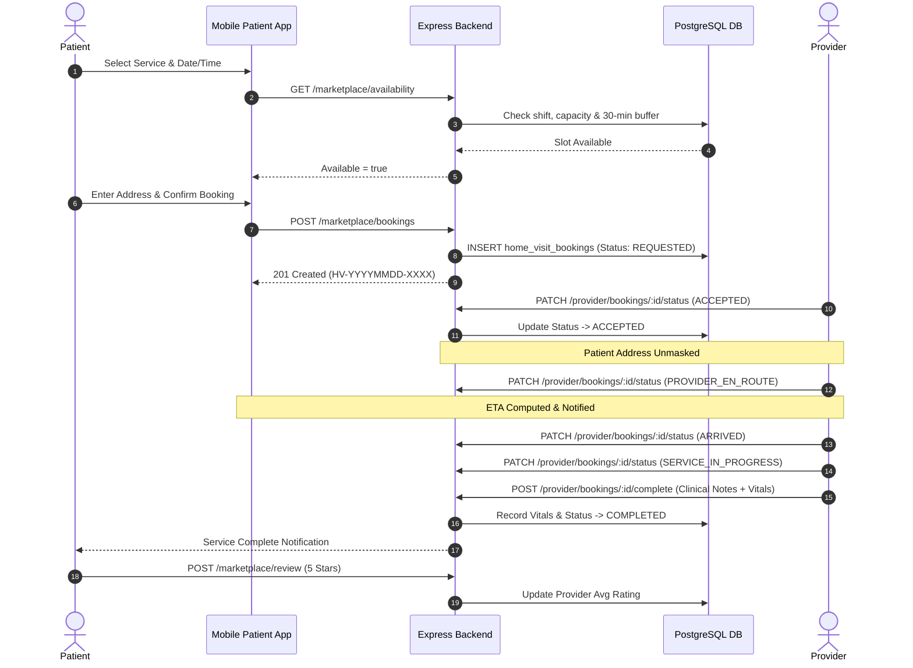

# PHASE 9 — HOME HEALTHCARE BOOKING WORKFLOW

## 1. Booking Sequence & Identifier Generation

Every home visit booking receives a deterministic, human-readable, sequential reference:

$$\text{Reference Format: } \mathbf{HV\text{-}YYYYMMDD\text{-}XXXX}$$

Example:
- `HV-20261112-0001` (First home visit booked on November 12, 2026)
- `HV-20261112-0002` (Second home visit)

---

## 2. Server-Authoritative Financial Calculation

To eliminate client-side tampering, all fees, taxes, and commissions are computed server-side:

1. **Base Service Fee:** Derived from `provider_services.custom_price` or `healthcare_services.base_price`.
2. **Travel Charge:** Computed based on estimated travel distance:
   - $\le 10\text{ km} \implies \text{INR } 50.00$
   - $> 10\text{ km} \implies \text{INR } 150.00$
3. **Subtotal:**
   $$\text{Subtotal} = \text{Service Fee} + \text{Travel Charge}$$
4. **GST (18% Healthcare Supportive Services):**
   $$\text{GST} = \text{Subtotal} \times 0.18$$
5. **Total Payable:**
   $$\text{Total Amount} = \text{Subtotal} + \text{GST}$$
6. **Platform Commission (15%):**
   $$\text{Platform Commission} = \text{Service Fee} \times 0.15$$
7. **Provider Net Payout (85%):**
   $$\text{Provider Payable} = \text{Service Fee} \times 0.85$$

---

## 3. End-to-End Booking Journey

