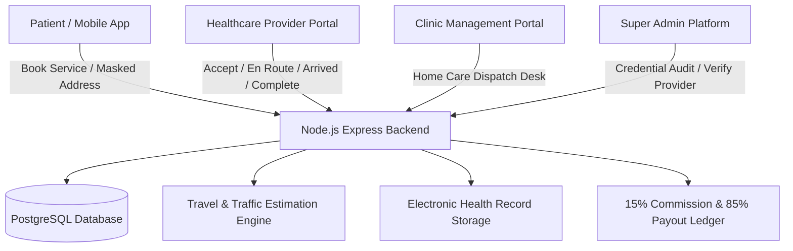

# PHASE 9 — HOME HEALTHCARE MARKETPLACE ARCHITECTURE

## 1. Architectural Overview

The Home Healthcare Marketplace engine connects four primary actors within the Smart Clinic OS ecosystem:
1. **Patients:** Discover healthcare services, select verified providers or request clinic dispatch, track visit arrival, and submit verified reviews.
2. **Healthcare Providers:** Doctors, Nurses, Physiotherapists, and Phlebotomists who accept bookings, navigate to patient homes, execute care, and document vital signs.
3. **Clinics:** Manage their affiliated home care team, dispatch providers, and monitor home healthcare volume alongside clinic OPD appointments.
4. **Super Admin:** Platform regulatory oversight, credential verification, license audit, and commission analytics.

---

## 2. Relational Database Architecture

The Phase 9 data model introduces 12 relational tables with foreign key constraints, UUID primary keys, and specialized indexes:

### 2.1 Service Catalog Hierarchy
- **`healthcare_service_categories`**:
  - `id` (UUID PK), `name`, `code` (e.g. `DOCTOR_VISIT`, `NURSING`, `PHYSIOTHERAPY`, `SAMPLE_COLLECTION`), `description`, `icon_name`, `display_order`, `is_active`.
- **`healthcare_services`**:
  - `id` (UUID PK), `category_id` (FK), `name`, `code`, `description`, `sac_code` (default `999312`), `base_price`, `default_duration_minutes`, `is_active`.

### 2.2 Provider Profiles & Qualifications
- **`healthcare_provider_profiles`**:
  - `id` (UUID PK), `user_id` (FK to `users`), `associated_clinic_id` (FK to `clinics`), `full_name`, `provider_type`, `qualification`, `specialty`, `experience_years`, `registration_number`, `registration_council`, `rating_avg`, `rating_count`, `verification_status` (`DRAFT`, `SUBMITTED`, `UNDER_REVIEW`, `APPROVED`, `REJECTED`, `SUSPENDED`).
- **`provider_credentials`**:
  - `id` (UUID PK), `provider_id` (FK), `credential_type`, `document_number`, `document_url`, `issued_date`, `expiry_date`, `verification_status`.
- **`provider_services`**:
  - `id` (UUID PK), `provider_id` (FK), `service_id` (FK), `custom_price`, `is_offered`.
- **`provider_service_areas`**:
  - `id` (UUID PK), `provider_id` (FK), `city`, `locality`, `postal_code`, `service_radius_km`, `base_latitude`, `base_longitude`.
- **`provider_availability`**:
  - `id` (UUID PK), `provider_id` (FK), `day_of_week` (0-6), `start_time`, `end_time`, `max_daily_visits`, `buffer_minutes`, `is_active`.

### 2.3 Bookings & Care Lifecycle
- **`home_visit_bookings`**:
  - `id` (UUID PK), `booking_reference` (`HV-YYYYMMDD-XXXX`), `patient_id` (FK), `booked_by_user_id` (FK), `provider_id` (FK), `service_id` (FK), `service_category_id` (FK), `clinic_id` (FK), `status`, `scheduled_date`, `scheduled_start_time`, `scheduled_end_time`, `estimated_travel_minutes`, `estimated_travel_distance_km`, `service_address`, `city`, `postal_code`, `latitude`, `longitude`, `contact_phone`, `service_price`, `travel_charge`, `tax_amount`, `total_amount`, `platform_commission_amount` (15%), `provider_payable_amount` (85%), `payment_status`, `payment_method`, `completed_at`, `cancelled_at`.
- **`home_visit_status_history`**:
  - `id` (UUID PK), `booking_id` (FK), `from_status`, `to_status`, `changed_by_user_id` (FK), `reason`, `notes`, `created_at`.
- **`home_visit_service_records`**:
  - `id` (UUID PK), `booking_id` (FK), `provider_id` (FK), `started_at`, `completed_at`, `clinical_observations`, `vitals` (JSONB), `procedure_notes`, `checklist_completed` (JSONB), `follow_up_recommendation`, `prescription_id` (FK).
- **`provider_reviews`**:
  - `id` (UUID PK), `booking_id` (FK), `provider_id` (FK), `patient_id` (FK), `rating` (1-5), `punctuality_rating`, `review_text`, `is_verified_visit`, `is_moderated`.
- **`provider_complaints`**:
  - `id` (UUID PK), `booking_id` (FK), `provider_id` (FK), `patient_id` (FK), `complaint_category`, `description`, `status`.

---

## 3. High-Availability Scalability Features
- Connection pooling with automatic reconnection.
- PostgreSQL database indexes on foreign keys, statuses, and dates to ensure sub-10ms response times.
- Explicit database transactions (`BEGIN` ... `COMMIT` / `ROLLBACK`) for booking creation and state transitions.

