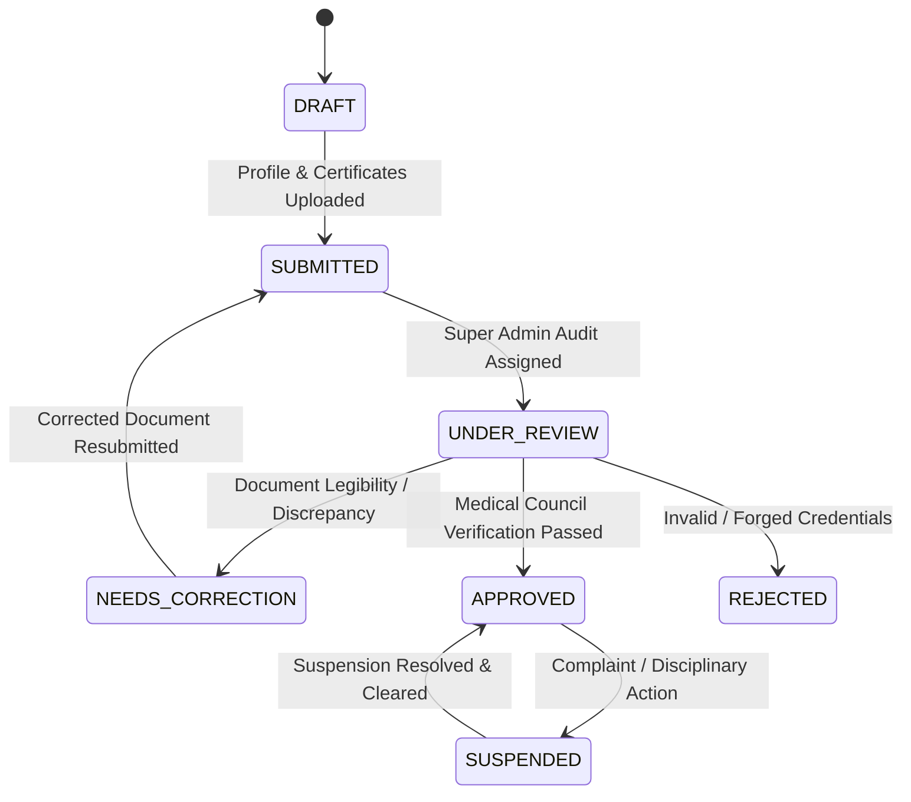

# PHASE 9 — HEALTHCARE PROFESSIONAL VERIFICATION WORKFLOW

## 1. Regulatory Context

In compliance with Indian healthcare regulations and the National Medical Commission (NMC) guidelines, only verified and credentialed professionals may practice or provide medical treatments.

Unverified individuals are strictly quarantined from public discovery and booking assignment.

---

## 2. Verification State Machine

### 2.1 State Definitions

1. **`DRAFT`**: Provider is creating profile; certificates and council registration pending.
2. **`SUBMITTED`**: Provider submitted profile, government ID, degree, and council registration certificate.
3. **`UNDER_REVIEW`**: Compliance auditor is performing registry lookups on the respective state medical / nursing council portal.
4. **`NEEDS_CORRECTION`**: Auditor flagged a specific field (e.g. illegible certificate scan) requiring provider re-upload.
5. **`APPROVED`**: Credentials verified; provider is active and publicly discoverable.
6. **`REJECTED`**: Registration could not be authenticated or violated medical compliance standards.
7. **`SUSPENDED`**: Temporarily or permanently removed from dispatch due to disciplinary review or license lapse.

---

## 3. Verified Provider Personas (Seed Credentials)

| Provider Name | Role | Email | Password | Registration Details | Status |
| :--- | :--- | :--- | :--- | :--- | :--- |
| **Dr. Rajesh Sharma** | Doctor (MD) | `doctor.home@careplus.in` | `Password@123` | KMC-2012-44912 (Karnataka Medical Council) | `APPROVED` |
| **Sister Mary Varghese** | Registered Nurse (RN) | `nurse.mary@careplus.in` | `Password@123` | KNC-2015-88392 (Karnataka Nursing Council) | `APPROVED` |
| **Dr. Arun Kumar, BPT** | Physiotherapist | `physio.arun@careplus.in` | `Password@123` | IAP-2016-19402 (Indian Association of Physios) | `APPROVED` |
| **Suresh Nair** | Phlebotomist | `lab.suresh@careplus.in` | `Password@123` | DMLT-KA-2018-091 (Para-Medical Board) | `APPROVED` |

